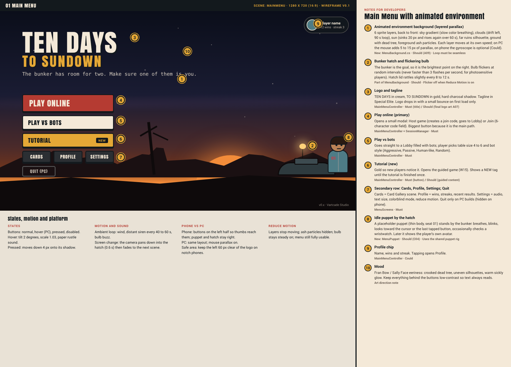
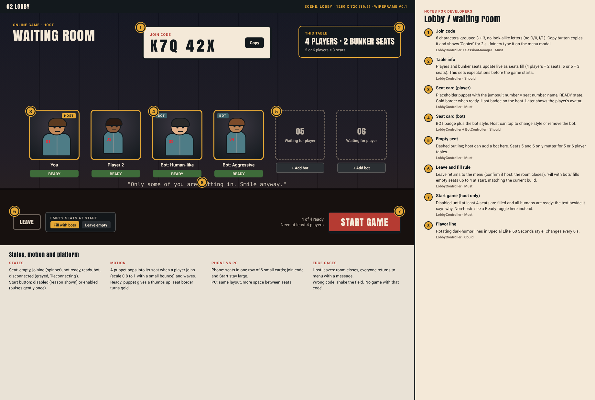
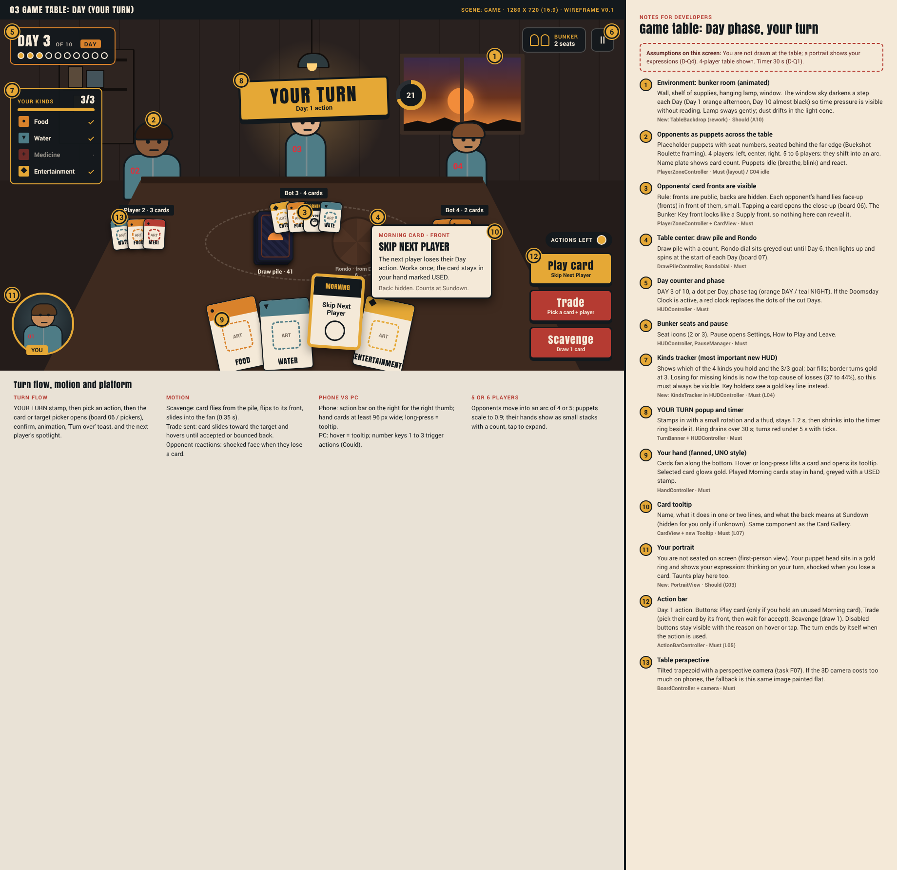
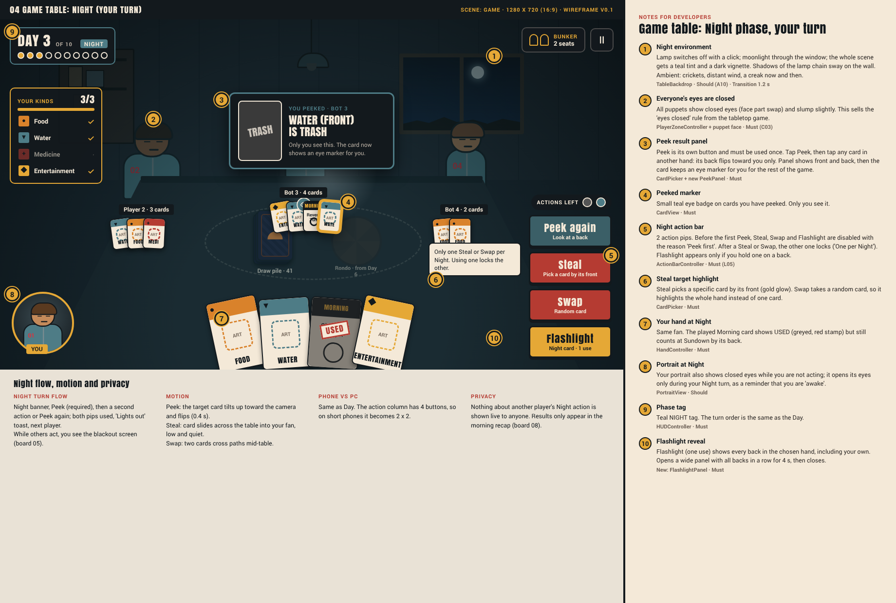
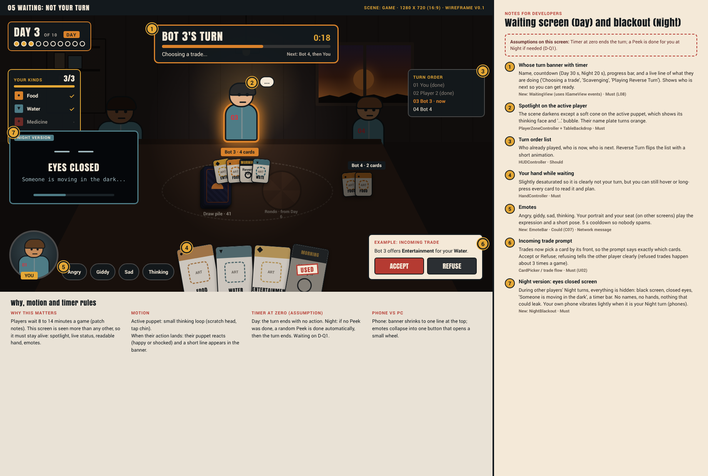
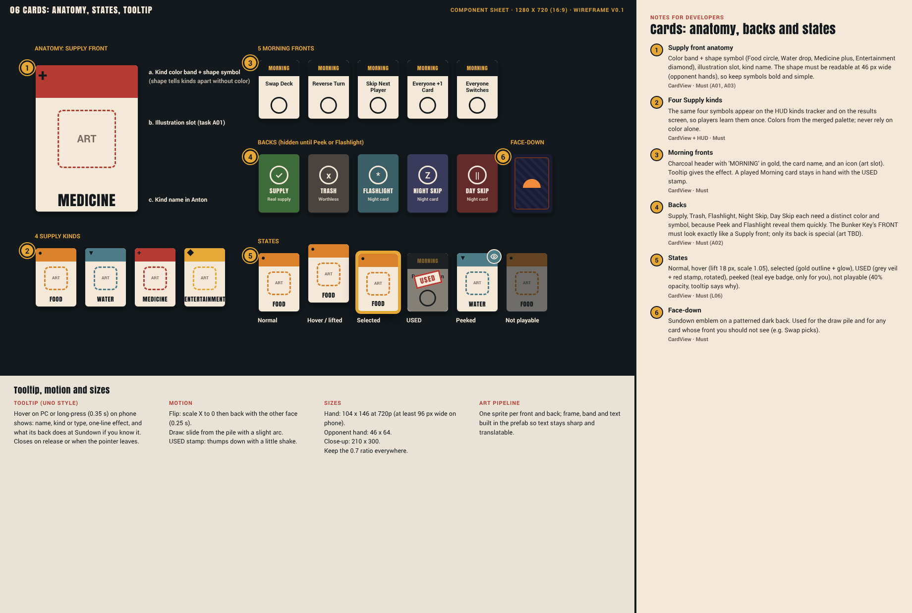
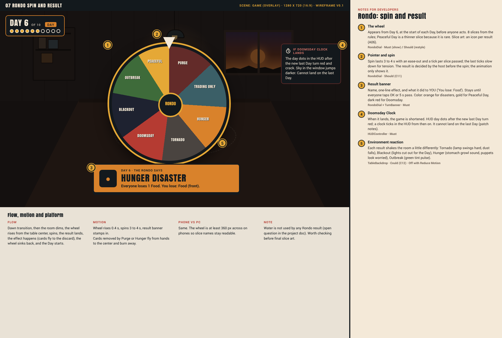
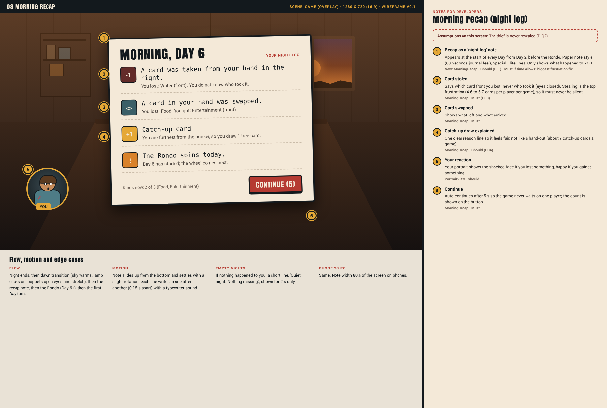
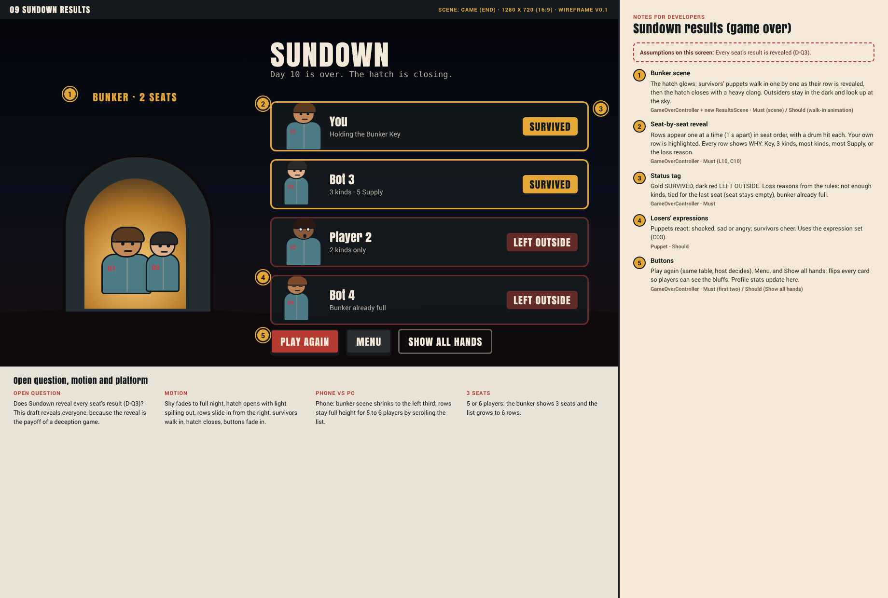

# Wireframes v0.1: Developer Notes

Initial idea draft (2026-11-21). Colors are final-palette; puppets, card art and environments are placeholders. Each board's numbered callouts match the numbered notes below. Priority tags (Must / Should / Could) and task IDs match the UI/UX Polish Checklist.

Open each board as an image in `png/`, or open the matching file in `html/` in a browser (fonts load from `Assets/_Project/Resources/Fonts`).

## 01 Main Menu

Scene: `MainMenu` · File: `html/01_MainMenu.html`

| # | Element | What it does | Owner script · priority |
|---|---|---|---|
| 1 | **Animated environment background (layered parallax)** | 6 sprite layers, back to front: sky gradient (slow color breathing), clouds (drift left, 90 s loop), sun (sinks 20 px and rises again over 60 s), far ruins silhouette, ground with dead tree, foreground ash particles. Each layer moves at its own speed; on PC the mouse adds 5 to 15 px of parallax, on phone the gyroscope is optional (Could). | New: MenuBackground.cs · Should (A09) · Loop must be seamless |
| 2 | **Bunker hatch and flickering bulb** | The bunker is the goal, so it is the brightest point on the right. Bulb flickers at random intervals (never faster than 3 flashes per second, for photosensitive players). Hatch lid rattles slightly every 8 to 12 s. | Part of MenuBackground · Should · Flicker off when Reduce Motion is on |
| 3 | **Logo and tagline** | TEN DAYS in cream, TO SUNDOWN in gold, hard charcoal shadow. Tagline in Special Elite. Logo drops in with a small bounce on first load only. | MainMenuController · Must (title) / Should (final logo art A07) |
| 4 | **Play online (primary)** | Opens a small modal: Host game (creates a join code, goes to Lobby) or Join (6-character code field). Biggest button because it is the main path. | MainMenuController + SessionManager · Must |
| 5 | **Play vs bots** | Goes straight to a Lobby filled with bots; player picks table size 4 to 6 and bot style (Aggressive, Passive, Human-like, Random). | MainMenuController · Must |
| 6 | **Tutorial (new)** | Gold so new players notice it. Opens the guided game (W15). Shows a NEW tag until the tutorial is finished once. | MainMenuController · Must (button) / Should (guided content) |
| 7 | **Secondary row: Cards, Profile, Settings; Quit** | Cards = Card Gallery scene. Profile = wins, streaks, recent results. Settings = audio, text size, colorblind mode, reduce motion. Quit only on PC builds (hidden on phone). | MenuScreens · Must |
| 8 | **Idle puppet by the hatch** | A placeholder puppet (thin body, seat 01) stands by the bunker: breathes, blinks, looks toward the cursor or the last tapped button, occasionally checks a wristwatch. Later it shows the player's own avatar. | New: MenuPuppet · Should (C04) · Uses the shared puppet rig |
| 9 | **Profile chip** | Name, wins and streak. Tapping opens Profile. | MainMenuController · Could |
| 10 | **Mood** | Fran Bow / Sally Face eeriness: crooked dead tree, uneven silhouettes, warm sickly glow. Keep everything behind the buttons low-contrast so text always reads. | Art direction note |

**States:** Buttons: normal, hover (PC), pressed, disabled. Hover: tilt 2 degrees, scale 1.03, paper rustle sound. Pressed: moves down 4 px onto its shadow.

**Motion and sound:** Ambient loop: wind, distant siren every 40 to 60 s, bulb buzz. Screen change: the camera pans down into the hatch (0.6 s) then fades to the next scene.

**Phone vs PC:** Phone: buttons on the left half so thumbs reach them; puppet and hatch stay right. PC: same layout; mouse parallax on. Safe area: keep the left 60 px clear of the logo on notch phones.

**Reduce motion:** Layers stop moving; ash particles hidden; bulb stays steady on; menu still fully usable.

## 02 Lobby

Scene: `Lobby` · File: `html/02_Lobby.html`

| # | Element | What it does | Owner script · priority |
|---|---|---|---|
| 1 | **Join code** | 6 characters, grouped 3 + 3, no look-alike letters (no O/0, I/1). Copy button copies it and shows 'Copied' for 2 s. Joiners type it on the menu modal. | LobbyController + SessionManager · Must |
| 2 | **Table info** | Players and bunker seats update live as seats fill (4 players = 2 seats; 5 or 6 = 3 seats). This sets expectations before the game starts. | LobbyController · Should |
| 3 | **Seat card (player)** | Placeholder puppet with the jumpsuit number = seat number, name, READY state. Gold border when ready. Host badge on the host. Later shows the player's avatar. | LobbyController · Must |
| 4 | **Seat card (bot)** | BOT badge plus the bot style. Host can tap to change style or remove the bot. | LobbyController + BotController · Should |
| 5 | **Empty seat** | Dashed outline; host can add a bot here. Seats 5 and 6 only matter for 5 or 6 player tables. | LobbyController · Must |
| 6 | **Leave and fill rule** | Leave returns to the menu (confirm if host: the room closes). 'Fill with bots' fills empty seats up to 4 at start, matching the current build. | LobbyController · Must |
| 7 | **Start game (host only)** | Disabled until at least 4 seats are filled and all humans are ready; the text beside it says why. Non-hosts see a Ready toggle here instead. | LobbyController · Must |
| 8 | **Flavor line** | Rotating dark-humor lines in Special Elite, 60 Seconds style. Changes every 6 s. | LobbyController · Could |

**States:** Seat: empty, joining (spinner), not ready, ready, bot, disconnected (greyed, 'Reconnecting'). Start button: disabled (reason shown) or enabled (pulses gently once).

**Motion:** A puppet pops into its seat when a player joins (scale 0.8 to 1 with a small bounce) and waves. Ready: puppet gives a thumbs up; seat border turns gold.

**Phone vs PC:** Phone: seats in one row of 6 small cards; join code and Start stay large. PC: same layout, more space between seats.

**Edge cases:** Host leaves: room closes, everyone returns to menu with a message. Wrong code: shake the field, 'No game with that code'.

## 03 Game table: Day, your turn

Scene: `Game` · File: `html/03_Table_Day.html`

> **Assumption:** You are not drawn at the table; a portrait shows your expressions (D-Q4). 4-player table shown. Timer 30 s (D-Q1).

| # | Element | What it does | Owner script · priority |
|---|---|---|---|
| 1 | **Environment: bunker room (animated)** | Wall, shelf of supplies, hanging lamp, window. The window sky darkens a step each Day (Day 1 orange afternoon, Day 10 almost black) so time pressure is visible without reading. Lamp sways gently; dust drifts in the light cone. | New: TableBackdrop (rework) · Should (A10) |
| 2 | **Opponents as puppets across the table** | Placeholder puppets with seat numbers, seated behind the far edge (Buckshot Roulette framing). 4 players: left, center, right. 5 to 6 players: they shift into an arc. Name plate shows card count. Puppets idle (breathe, blink) and react. | PlayerZoneController · Must (layout) / C04 idle |
| 3 | **Opponents' card fronts are visible** | Rule: fronts are public, backs are hidden. Each opponent's hand lies face-up (fronts) in front of them, small. Tapping a card opens the close-up (board 06). The Bunker Key front looks like a Supply front, so nothing here can reveal it. | PlayerZoneController + CardView · Must |
| 4 | **Table center: draw pile and Rondo** | Draw pile with a count. Rondo dial sits greyed out until Day 6, then lights up and spins at the start of each Day (board 07). | DrawPileController, RondoDial · Must |
| 5 | **Day counter and phase** | DAY 3 of 10, a dot per Day, phase tag (orange DAY / teal NIGHT). If the Doomsday Clock is active, a red clock replaces the dots of the cut Days. | HUDController · Must |
| 6 | **Bunker seats and pause** | Seat icons (2 or 3). Pause opens Settings, How to Play and Leave. | HUDController, PauseManager · Must |
| 7 | **Kinds tracker (most important new HUD)** | Shows which of the 4 kinds you hold and the 3/3 goal; bar fills; border turns gold at 3. Losing for missing kinds is now the top cause of losses (37 to 44%), so this must always be visible. Key holders see a gold key line instead. | New: KindsTracker in HUDController · Must (L04) |
| 8 | **YOUR TURN popup and timer** | Stamps in with a small rotation and a thud, stays 1.2 s, then shrinks into the timer ring beside it. Ring drains over 30 s; turns red under 5 s with ticks. | TurnBanner + HUDController · Must |
| 9 | **Your hand (fanned, UNO style)** | Cards fan along the bottom. Hover or long-press lifts a card and opens its tooltip. Selected card glows gold. Played Morning cards stay in hand, greyed with a USED stamp. | HandController · Must |
| 10 | **Card tooltip** | Name, what it does in one or two lines, and what the back means at Sundown (hidden for you only if unknown). Same component as the Card Gallery. | CardView + new Tooltip · Must (L07) |
| 11 | **Your portrait** | You are not seated on screen (first-person view). Your puppet head sits in a gold ring and shows your expression: thinking on your turn, shocked when you lose a card. Taunts play here too. | New: PortraitView · Should (C03) |
| 12 | **Action bar** | Day: 1 action. Buttons: Play card (only if you hold an unused Morning card), Trade (pick their card by its front, then wait for accept), Scavenge (draw 1). Disabled buttons stay visible with the reason on hover or tap. The turn ends by itself when the action is used. | ActionBarController · Must (L05) |
| 13 | **Table perspective** | Tilted trapezoid with a perspective camera (task F07). If the 3D camera costs too much on phones, the fallback is this same image painted flat. | BoardController + camera · Must |

**Turn flow:** YOUR TURN stamp, then pick an action, then the card or target picker opens (board 06 / pickers), confirm, animation, 'Turn over' toast, and the next player's spotlight.

**Motion:** Scavenge: card flies from the pile, flips to its front, slides into the fan (0.35 s). Trade sent: card slides toward the target and hovers until accepted or bounced back. Opponent reactions: shocked face when they lose a card.

**Phone vs PC:** Phone: action bar on the right for the right thumb; hand cards at least 96 px wide; long-press = tooltip. PC: hover = tooltip; number keys 1 to 3 trigger actions (Could).

**5 or 6 players:** Opponents move into an arc of 4 or 5; puppets scale to 0.9; their hands show as small stacks with a count, tap to expand.

## 04 Game table: Night, your turn

Scene: `Game` · File: `html/04_Table_Night.html`

| # | Element | What it does | Owner script · priority |
|---|---|---|---|
| 1 | **Night environment** | Lamp switches off with a click; moonlight through the window; the whole scene gets a teal tint and a dark vignette. Shadows of the lamp chain sway on the wall. Ambient: crickets, distant wind, a creak now and then. | TableBackdrop · Should (A10) · Transition 1.2 s |
| 2 | **Everyone's eyes are closed** | All puppets show closed eyes (face part swap) and slump slightly. This sells the 'eyes closed' rule from the tabletop game. | PlayerZoneController + puppet face · Must (C03) |
| 3 | **Peek result panel** | Peek is its own button and must be used once. Tap Peek, then tap any card in another hand: its back flips toward you only. Panel shows front and back, then the card keeps an eye marker for you for the rest of the game. | CardPicker + new PeekPanel · Must |
| 4 | **Peeked marker** | Small teal eye badge on cards you have peeked. Only you see it. | CardView · Must |
| 5 | **Night action bar** | 2 action pips. Before the first Peek, Steal, Swap and Flashlight are disabled with the reason 'Peek first'. After a Steal or Swap, the other one locks ('One per Night'). Flashlight appears only if you hold one on a back. | ActionBarController · Must (L05) |
| 6 | **Steal target highlight** | Steal picks a specific card by its front (gold glow). Swap takes a random card, so it highlights the whole hand instead of one card. | CardPicker · Must |
| 7 | **Your hand at Night** | Same fan. The played Morning card shows USED (greyed, red stamp) but still counts at Sundown by its back. | HandController · Must |
| 8 | **Portrait at Night** | Your portrait also shows closed eyes while you are not acting; it opens its eyes only during your Night turn, as a reminder that you are 'awake'. | PortraitView · Should |
| 9 | **Phase tag** | Teal NIGHT tag. The turn order is the same as the Day. | HUDController · Must |
| 10 | **Flashlight reveal** | Flashlight (one use) shows every back in the chosen hand, including your own. Opens a wide panel with all backs in a row for 4 s, then closes. | New: FlashlightPanel · Must |

**Night turn flow:** Night banner, Peek (required), then a second action or Peek again; both pips used, 'Lights out' toast, next player. While others act, you see the blackout screen (board 05).

**Motion:** Peek: the target card tilts up toward the camera and flips (0.4 s). Steal: card slides across the table into your fan, low and quiet. Swap: two cards cross paths mid-table.

**Phone vs PC:** Same as Day. The action column has 4 buttons, so on short phones it becomes 2 x 2.

**Privacy:** Nothing about another player's Night action is shown live to anyone. Results only appear in the morning recap (board 08).

## 05 Waiting (not your turn) and Night blackout

Scene: `Game` · File: `html/05_Waiting.html`

> **Assumption:** Timer at zero ends the turn; a Peek is done for you at Night if needed (D-Q1).

| # | Element | What it does | Owner script · priority |
|---|---|---|---|
| 1 | **Whose turn banner with timer** | Name, countdown (Day 30 s, Night 20 s), progress bar, and a live line of what they are doing ('Choosing a trade', 'Scavenging', 'Playing Reverse Turn'). Shows who is next so you can get ready. | New: WaitingView (uses IGameView events) · Must (L08) |
| 2 | **Spotlight on the active player** | The scene darkens except a soft cone on the active puppet, which shows its thinking face and '...' bubble. Their name plate turns orange. | PlayerZoneController + TableBackdrop · Must |
| 3 | **Turn order list** | Who already played, who is now, who is next. Reverse Turn flips the list with a short animation. | HUDController · Should |
| 4 | **Your hand while waiting** | Slightly desaturated so it is clearly not your turn, but you can still hover or long-press every card to read it and plan. | HandController · Must |
| 5 | **Emotes** | Angry, giddy, sad, thinking. Your portrait and your seat (on other screens) play the expression and a short pose. 5 s cooldown so nobody spams. | New: EmoteBar · Could (C07) · Network message |
| 6 | **Incoming trade prompt** | Trades now pick a card by its front, so the prompt says exactly which cards. Accept or Refuse; refusing tells the other player clearly (refused trades happen about 3 times a game). | CardPicker / trade flow · Must (U02) |
| 7 | **Night version: eyes closed screen** | During other players' Night turns, everything is hidden: black screen, closed eyes, 'Someone is moving in the dark', a timer bar. No names, no hands, nothing that could leak. Your own phone vibrates lightly when it is your Night turn (phones). | New: NightBlackout · Must |

**Why this matters:** Players wait 8 to 14 minutes a game (patch notes). This screen is seen more than any other, so it must stay alive: spotlight, live status, readable hand, emotes.

**Motion:** Active puppet: small thinking loop (scratch head, tap chin). When their action lands: their puppet reacts (happy or shocked) and a short line appears in the banner.

**Timer at zero (assumption):** Day: the turn ends with no action. Night: if no Peek was done, a random Peek is done automatically, then the turn ends. Waiting on D-Q1.

**Phone vs PC:** Phone: banner shrinks to one line at the top; emotes collapse into one button that opens a small wheel.

## 06 Cards: anatomy, states, tooltip

Scene: `Component sheet` · File: `html/06_Cards.html`

| # | Element | What it does | Owner script · priority |
|---|---|---|---|
| 1 | **Supply front anatomy** | Color band + shape symbol (Food circle, Water drop, Medicine plus, Entertainment diamond), illustration slot, kind name. The shape must be readable at 46 px wide (opponent hands), so keep symbols bold and simple. | CardView · Must (A01, A03) |
| 2 | **Four Supply kinds** | The same four symbols appear on the HUD kinds tracker and on the results screen, so players learn them once. Colors from the merged palette; never rely on color alone. | CardView + HUD · Must |
| 3 | **Morning fronts** | Charcoal header with 'MORNING' in gold, the card name, and an icon (art slot). Tooltip gives the effect. A played Morning card stays in hand with the USED stamp. | CardView · Must |
| 4 | **Backs** | Supply, Trash, Flashlight, Night Skip, Day Skip each need a distinct color and symbol, because Peek and Flashlight reveal them quickly. The Bunker Key's FRONT must look exactly like a Supply front; only its back is special (art TBD). | CardView · Must (A02) |
| 5 | **States** | Normal, hover (lift 18 px, scale 1.05), selected (gold outline + glow), USED (grey veil + red stamp, rotated), peeked (teal eye badge, only for you), not playable (40% opacity, tooltip says why). | CardView · Must (L06) |
| 6 | **Face-down** | Sundown emblem on a patterned dark back. Used for the draw pile and for any card whose front you should not see (e.g. Swap picks). | CardView · Must |

**Tooltip (UNO style):** Hover on PC or long-press (0.35 s) on phone shows: name, kind or type, one-line effect, and what its back does at Sundown if you know it. Closes on release or when the pointer leaves.

**Motion:** Flip: scale X to 0 then back with the other face (0.25 s). Draw: slide from the pile with a slight arc. USED stamp: thumps down with a little shake.

**Sizes:** Hand: 104 x 146 at 720p (at least 96 px wide on phone). Opponent hand: 46 x 64. Close-up: 210 x 300. Keep the 0.7 ratio everywhere.

**Art pipeline:** One sprite per front and back; frame, band and text built in the prefab so text stays sharp and translatable.

## 07 Rondo spin and result

Scene: `Game (overlay)` · File: `html/07_Rondo.html`

| # | Element | What it does | Owner script · priority |
|---|---|---|---|
| 1 | **The wheel** | Appears from Day 6, at the start of each Day, before anyone acts. 8 slices from the rules; Peaceful Day is a thinner slice because it is rare. Slice art: an icon per result (A06). | RondoDial · Must (show) / Should (restyle) |
| 2 | **Pointer and spin** | Spin lasts 3 to 4 s with an ease-out and a tick per slice passed; the last ticks slow down for tension. The result is decided by the host before the spin; the animation only shows it. | RondoDial · Should (C11) |
| 3 | **Result banner** | Name, one-line effect, and what it did to YOU ('You lose: Food'). Stays until everyone taps OK or 5 s pass. Color: orange for disasters, gold for Peaceful Day, dark red for Doomsday. | RondoDial + TurnBanner · Must |
| 4 | **Doomsday Clock** | When it lands, the game is shortened. HUD day dots after the new last Day turn red; a clock ticks in the HUD from then on. It cannot land on the last Day (patch notes). | HUDController · Must |
| 5 | **Environment reaction** | Each result shakes the room a little differently: Tornado (lamp swings hard, dust falls), Blackout (lights cut out for the Day), Hunger (stomach growl sound, puppets look worried), Outbreak (green tint pulse). | TableBackdrop · Could (C12) · Off with Reduce Motion |

**Flow:** Dawn transition, then the room dims, the wheel rises from the table center, spins, the result lands, the effect happens (cards fly to the discard), the wheel sinks back, and the Day starts.

**Motion:** Wheel rises 0.4 s, spins 3 to 4 s, result banner stamps in. Cards removed by Purge or Hunger fly from hands to the center and burn away.

**Phone vs PC:** Same. The wheel is at least 360 px across on phones so slice names stay readable.

**Note:** Water is not used by any Rondo result (open question in the project doc). Worth checking before final slice art.

## 08 Morning recap

Scene: `Game (overlay)` · File: `html/08_MorningRecap.html`

> **Assumption:** The thief is never revealed (D-Q2).

| # | Element | What it does | Owner script · priority |
|---|---|---|---|
| 1 | **Recap as a 'night log' note** | Appears at the start of every Day from Day 2, before the Rondo. Paper note style (60 Seconds journal feel), Special Elite lines. Only shows what happened to YOU. | New: MorningRecap · Should (L11) · Must if time allows: biggest frustration fix |
| 2 | **Card stolen** | Says which card front you lost; never who took it (eyes closed). Stealing is the top frustration (4.6 to 5.7 cards per player per game), so it must never be silent. | MorningRecap · Must (U03) |
| 3 | **Card swapped** | Shows what left and what arrived. | MorningRecap · Must |
| 4 | **Catch-up draw explained** | One clear reason line so it feels fair, not like a hand-out (about 7 catch-up cards a game). | MorningRecap · Should (U04) |
| 5 | **Your reaction** | Your portrait shows the shocked face if you lost something, happy if you gained something. | PortraitView · Should |
| 6 | **Continue** | Auto-continues after 5 s so the game never waits on one player; the count is shown on the button. | MorningRecap · Must |

**Flow:** Night ends, then dawn transition (sky warms, lamp clicks on, puppets open eyes and stretch), then the recap note, then the Rondo (Day 6+), then the first Day turn.

**Motion:** Note slides up from the bottom and settles with a slight rotation; each line writes in one after another (0.15 s apart) with a typewriter sound.

**Empty nights:** If nothing happened to you: a short line, 'Quiet night. Nothing missing.', shown for 2 s only.

**Phone vs PC:** Same. Note width 80% of the screen on phones.

## 09 Sundown results

Scene: `Game (end)` · File: `html/09_SundownResults.html`

> **Assumption:** Every seat's result is revealed (D-Q3).

| # | Element | What it does | Owner script · priority |
|---|---|---|---|
| 1 | **Bunker scene** | The hatch glows; survivors' puppets walk in one by one as their row is revealed, then the hatch closes with a heavy clang. Outsiders stay in the dark and look up at the sky. | GameOverController + new ResultsScene · Must (scene) / Should (walk-in animation) |
| 2 | **Seat-by-seat reveal** | Rows appear one at a time (1 s apart) in seat order, with a drum hit each. Your own row is highlighted. Every row shows WHY: Key, 3 kinds, most kinds, most Supply, or the loss reason. | GameOverController · Must (L10, C10) |
| 3 | **Status tag** | Gold SURVIVED, dark red LEFT OUTSIDE. Loss reasons from the rules: not enough kinds, tied for the last seat (seat stays empty), bunker already full. | GameOverController · Must |
| 4 | **Losers' expressions** | Puppets react: shocked, sad or angry; survivors cheer. Uses the expression set (C03). | Puppet · Should |
| 5 | **Buttons** | Play again (same table, host decides), Menu, and Show all hands: flips every card so players can see the bluffs. Profile stats update here. | GameOverController · Must (first two) / Should (Show all hands) |

**Open question:** Does Sundown reveal every seat's result (D-Q3)? This draft reveals everyone, because the reveal is the payoff of a deception game.

**Motion:** Sky fades to full night, hatch opens with light spilling out, rows slide in from the right, survivors walk in, hatch closes, buttons fade in.

**Phone vs PC:** Phone: bunker scene shrinks to the left third; rows stay full height for 5 to 6 players by scrolling the list.

**3 seats:** 5 or 6 players: the bunker shows 3 seats and the list grows to 6 rows.
